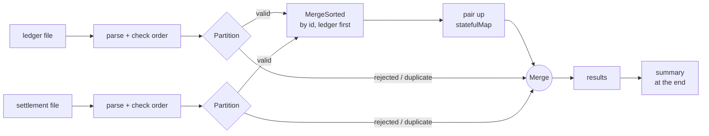
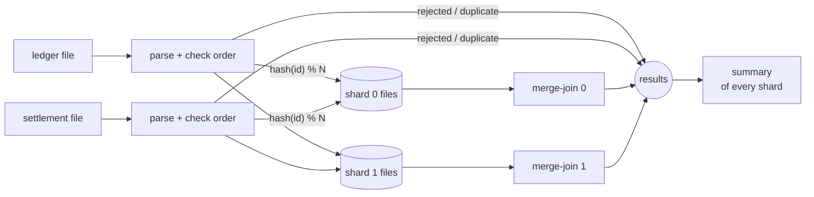

# settlement-reconciler

Streaming **settlement reconciliation** in **Scala 3** with **Apache Pekko Streams** and **Pekko HTTP**:
it reconciles an acquirer's settlement file against the company's own ledger, line by line, with
**constant memory**, whatever the size of the files.

> Everything runs locally and for free: JDK 25 and sbt are all you need. No database, no Docker,
> no API keys. The data is synthetic.

## The problem

Every day, the card acquirer (the company that processes card payments for a merchant) sends a
**settlement file**: every transaction it paid out, and for how much. Finance has to **reconcile**
it against the **ledger**, the company's own record of what it sold:

| Outcome | Meaning |
|---|---|
| **matched** | In both files, same amount and currency |
| **discrepancy** | In both files, but the amount or the currency differ |
| **missing_in_settlement** | In our ledger, but the acquirer didn't pay it: money we expected and didn't get |
| **missing_in_ledger** | Paid by the acquirer, but unknown to us: money we can't explain |
| **duplicate** | The same transaction id more than once in a file |
| **rejected** | A line that couldn't be parsed |

Settlement files easily reach millions of lines, so loading them into memory (or into a map to look
transactions up) doesn't scale. This project reconciles them **as streams**.

## How it works: a streaming merge-join

Both files are sorted by `transaction_id`. They are read **at the same time**, in id order, so the
two records of a transaction meet as they go by, like a database merge join. Only the current line
of each file is held in memory, and each result is emitted as soon as it's known.



- **Parse + check order** (`Csv`, `Reconciler.checked`): the bytes are split into lines whatever
  the chunk boundaries, holding at most 1,024 bytes; each line becomes a `Record` or a `Rejected`
  result (malformed, or longer than 1,024 bytes). A repeated id becomes a `Duplicate`, and an id
  going **backwards** stops the run with an `UnsortedInputException` saying where, since the
  merge-join depends on sorted input.
- **Partition** sends valid records to the merge and issues straight to the output, so a bad line
  never blocks the reconciliation.
- **MergeSorted** interleaves both files by `(transaction id, side)`: a transaction's ledger record
  comes out right before its settlement record.
- **Pair up** (`statefulMap`) holds at most one record: the next one either has the same id (matched
  or discrepancy) or not (the held one is missing on the other side).
- **Summary**: a final `statefulMap` counts every result and emits the totals once both files are done.

Backpressure is end to end: a slow consumer (e.g. an HTTP client reading slowly) slows the file
reads down instead of piling results up.

**A run is only valid if it ends with the summary.** Disorder in a file can show up anywhere, even on
its last line, and the results before it are already out by then (for example, a ledger listing
`tx-3` before `tx-2` first reports `tx-2` as missing from the ledger). That's inherent to streaming:
the alternative would be holding every result back until the end. So a run that stops with an error
never emits the summary, the HTTP response then has no `end` line, and the CLI exits with status 1:
whatever was received must be discarded.

## Sharding

A single run uses one CPU for the merge-join. `?shards=N` (or the CLI's third argument) splits the
reconciliation into N independent ones by transaction id: both files are split with the same
function, `hash(transaction_id) % N`, so the two records of a transaction always land in the same
shard. It runs in two phases, like a database's **Grace hash join**:



1. **Split:** each file is read once, parsed and checked exactly as in a single run (rejected and
   duplicate lines come out right away, with their line numbers in the original file; an unsorted
   file stops the run here), and each valid record is written to its shard's file, in order.
2. **Reconcile:** the N pairs of shard files are reconciled **in parallel** by the same merge-join,
   and their results are merged into one stream. Pekko fuses a whole stream, sub-streams included,
   into a single actor (one thread at a time), so each shard's merge-join, like each file's split,
   is marked `.async` to get an actor of its own.
3. **Summarize:** the summary adds up the results of every shard. Counting is associative, so the
   order in which shards finish doesn't matter, and the summary is the same as a single run's.

**Why files, not N in-memory streams:** splitting each file into N streams feeding N merge-joins can
deadlock. Shard 0's merge-join holds a ledger record and waits for the next settlement record of shard
0; that record is behind settlement records of shard 1, whose buffer is full because shard 1's
merge-join waits for a ledger record, which is behind the one shard 0 holds. No fixed buffer size
prevents it for every pair of files. Writing a shard file never waits for anything, so each file is
split at its own pace, still with constant memory.

The trade-offs: results from different shards are interleaved (no longer in transaction id order),
and the files are written to disk once more. On one machine the split phase reads each file
sequentially, so the gain is in the merge-join; the bigger point is that each pair of shard files is a
self-contained unit of work, which is what would let shards run in separate processes or machines. The
shard files are deleted when the run ends, however it ends.

## API

### `POST /settlements/{date}/reconciliation[?shards=N]`

The request body is the acquirer's settlement file for `date` (`YYYY-MM-DD`). The ledger side is the
company's own export, read from `LEDGER_DIR/ledger-{date}.csv`. The response is **streamed as NDJSON**
(`application/x-ndjson`, chunked): one JSON object per result, then a summary.

The upload is first written to a temporary file (streamed, with constant memory, and with no size
limit), then reconciled from disk while the response streams; the file is deleted when the response
ends. That keeps the request and the response independent, so it works with clients that send the
whole body before reading the response, such as Python's `requests`.

`shards` (1 to 16, default 1) reconciles in that many shards, in parallel (see
[Sharding](#sharding)): same results and summary, interleaved in another order.

```bash
sbt run    # starts the server on port 8080, with sample-data as LEDGER_DIR

curl -N --data-binary @sample-data/settlement-2026-11-10.csv \
  -H "Content-Type: text/csv" localhost:8080/settlements/2026-11-10/reconciliation
```

```json
{"type":"matched","transactionId":"tx-0001","amount":120.00,"currency":"BRL"}
{"type":"matched","transactionId":"tx-0002","amount":89.90,"currency":"BRL"}
{"type":"discrepancy","transactionId":"tx-0003","ledger":{"amount":45.00,"currency":"BRL"},"settlement":{"amount":40.00,"currency":"BRL"}}
{"type":"missing_in_settlement","transactionId":"tx-0004","amount":300.00,"currency":"BRL"}
{"type":"missing_in_ledger","transactionId":"tx-0005","amount":60.00,"currency":"BRL"}
{"type":"matched","transactionId":"tx-0006","amount":15.50,"currency":"BRL"}
{"type":"duplicate","transactionId":"tx-0006","amount":15.50,"currency":"BRL","side":"settlement","line":7}
{"type":"discrepancy","transactionId":"tx-0007","ledger":{"amount":99.99,"currency":"USD"},"settlement":{"amount":99.99,"currency":"BRL"}}
{"type":"rejected","side":"settlement","line":9,"reason":"invalid amount: abc"}
{"end":true,"summary":{"matched":3,"discrepancies":2,"missingInSettlement":1,"missingInLedger":1,"duplicates":1,"rejected":1,"matchedAmount":225.40,"missingInSettlementAmount":300.00,"missingInLedgerAmount":60.00}}
```

Paired results come out in transaction id order. Duplicates and rejected lines travel on their own
branch, so their position relative to the paired results may vary.

| Status | When |
|---|---|
| `200` | The reconciliation streams; it ends with the `{"end":true,…}` line |
| `400` | Invalid date, or `shards` not a number from 1 to 16 |
| `404` | No ledger export for that date |

A `200` response **without** the final `end` line was cut short, e.g. by an unsorted file, and its
results must be discarded: once a stream has started, its status can't change anymore.

**File format:** a `transaction_id,amount,currency` header, then one transaction per line
(`tx-0001,120.00,BRL`), sorted by `transaction_id`. Amounts have at most two decimal places and are
handled as integer cents, never as floating point.

## Running locally

Requirements: **JDK 25** and **sbt**.

```bash
sbt test                                   # the whole test suite
sbt run                                    # the HTTP server (LEDGER_DIR=sample-data, PORT=8080)

# Reconcile two local files from the command line (NDJSON on stdout; exit status 1 if the run fails)
sbt "runMain reconciler.Reconcile sample-data/ledger-2026-11-10.csv sample-data/settlement-2026-11-10.csv"

# The same in 4 shards, reconciled in parallel (the third argument, 1 to 16)
sbt "runMain reconciler.Reconcile sample-data/ledger-2026-11-10.csv sample-data/settlement-2026-11-10.csv 4"

# Generate a large pair of files (here 5 million transactions each, ~120 MB per file), streamed to disk
sbt "runMain reconciler.GenerateSample generated 5000000 2026-11-10"
LEDGER_DIR=generated sbt run
curl -N --data-binary @generated/settlement-2026-11-10.csv -H "Content-Type: text/csv" \
  localhost:8080/settlements/2026-11-10/reconciliation | tail -1
```

The generated files have a known mix of outcomes (every 40th transaction unsettled, every 50th
missing from the ledger, every 97th settled one cent off), so the summary can be checked exactly.

| Variable | Default | Description |
|---|---|---|
| `LEDGER_DIR` | `sample-data` | Directory with the `ledger-{date}.csv` exports |
| `PORT` | `8080` | HTTP port |

## Design decisions

- **Apache Pekko instead of Akka.** Akka moved to the Business Source License in 2022: production use
  needs a commercial license, and new versions are downloaded from Akka's own repository with a
  token. Pekko is the Apache 2.0 fork, on Maven Central, with native Scala 3 support and practically
  the same API (`org.apache.pekko.stream` instead of `akka.stream`), so Source/Flow/Sink, the Graph
  DSL and backpressure work the same. This project uses Pekko 1.7 with Pekko HTTP 1.4, which is
  built against the Pekko 1.x line (Pekko 2.0 has no matching Pekko HTTP release yet).
- **Merge-join over sorted files, not a lookup map.** Building a map of one file costs memory
  proportional to its size. A merge-join holds one line per file, so memory stays flat from 10 lines
  to 10 million. Sorted input is the price, and settlement and ledger exports can be produced sorted
  by id. An unsorted file stops the run with a precise error (side, line, ids); the results already
  streamed before the error must be discarded, which the missing summary signals.
- **Bad lines don't stop the run.** A malformed line, a line longer than 1,024 bytes or a duplicate
  id is reported as a result and skipped: one broken line in a 2 GB file shouldn't hide every other
  discrepancy. Lines are split by a small splitter that never buffers more than 1,024 bytes (Pekko's
  `Framing.delimiter` fails the stream on an overlong line instead). Only an unsorted file, which
  makes the whole reconciliation meaningless, fails the run.
- **Results stream out as they're found.** The HTTP response is NDJSON over chunked transfer
  encoding, so a client sees discrepancies while the files are still being read, and the server
  never builds the full result in memory.
- **The upload goes to disk before it's reconciled.** Reconciling straight from the request body
  would tie request and response together through backpressure: a client that only reads the
  response after sending the whole body would deadlock with the server once the network buffers
  fill. Storing the upload first (streamed, constant memory) costs some latency, since results start
  after the upload, and works with every client. The default 8 MB request size limit is lifted for
  this route only (`withoutSizeLimit`), since the body is never held in memory.
- **Sharding by transaction id, through files.** The shard key is the transaction id, the only key
  that keeps both halves of a transaction together. Shards are written to files rather than streamed
  in memory, which avoids a deadlock between shards (see [Sharding](#sharding)), and the summary is a
  sum, so partial summaries combine in any order.
- **Scriptable CLI.** `Reconcile` exits with 0 only when the run completes, 1 when it fails and 2 on
  wrong usage, so `Reconcile ... > results.ndjson && upload results.ndjson` never ships a partial run.
- **Money as integer cents.** Amounts are parsed into an opaque `Money` type backed by `Long`, so
  sums and comparisons are exact.

## Testing

```bash
sbt test
```

- **`MoneySpec` / `CsvSpec`:** amount parsing, CSV lines split across arbitrary chunk boundaries,
  CRLF, blank lines, a missing final newline, every kind of rejected line with its reason, and
  overlong lines (also split across chunks, or last without a newline) rejected without stopping
  the run.
- **`ReconcilerSpec`:** every outcome, files with missing transactions at the start, middle and end,
  an empty file, duplicates and rejected lines alongside the reconciliation, paired results in id
  order, an unsorted file failing with its line and never emitting the summary, the summary, and the
  sample files.
- **`ShardingSpec`:** ids spread over every shard; both files split at the same time, in separate
  actors (a barrier that only opens if they run concurrently); a line right at the 1,024-byte limit
  still accepted when its shard file is read back; 2, 3 and 4 shards giving exactly the same results
  as a single run (line numbers of duplicate and rejected lines included) and the same summary, on the
  sample files and on 20,000 generated transactions; an unsorted file stopping a sharded run before
  any shard is reconciled; the shard files deleted after a successful and a failed run.
- **`LargeFileSpec`:** 500,000 generated transactions per file reconciled to exactly the expected
  summary, and an **endless** pair of files reconciled lazily (taking 5 results ends the run), which
  would hang if any stage collected its input.
- **`ReconciliationRoutesSpec`:** the NDJSON response and its summary, 400 and 404, and over real
  HTTP: a ~12 MB streamed settlement upload (above the default 8 MB limit) reconciled in full, and a
  raw-socket client that sends its whole ~5 MB upload before reading anything still getting the
  full result, `shards` validation, and a reconciliation of 200,000 generated transactions in
  **2 shards** over real HTTP, returning one line per transaction and the expected summary.

## Tech stack

Scala 3.10 · JDK 25 · Apache Pekko Streams 1.7 · Pekko HTTP 1.4 · circe · munit · sbt · GitHub
Actions · Dependabot (sbt and GitHub Actions)

## License

[MIT](LICENSE)
